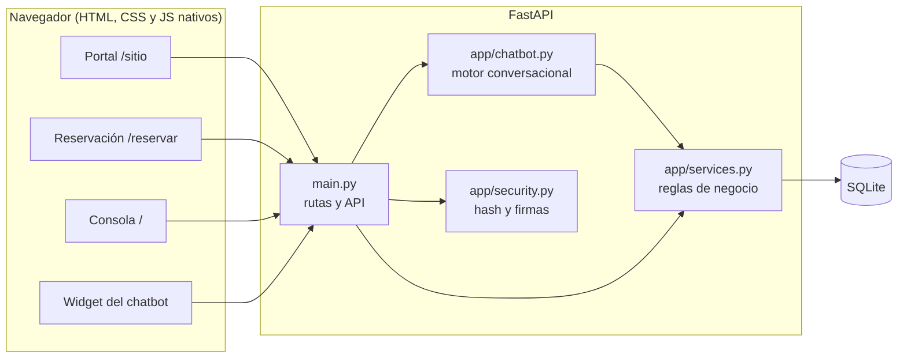
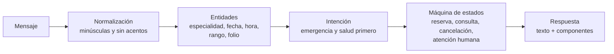

<div align="center">

# MediBot 360

**Recepción virtual, CRM y ERP para una clínica médica, sobre una sola base de datos.**


Proyecto de la asignatura *Sistemas Inteligentes* · Facultad de Ingeniería · Universidad Autónoma de Campeche

</div>

---

## Resumen

MediBot 360 es una plataforma web para una PyME médica **ficticia** en San Francisco de Campeche. Cumple el planteamiento de la práctica —una página web de una pequeña empresa que aplica, con herramientas gratuitas, un **chatbot**, un **CRM** y un **ERP**— y los integra sobre un único modelo de datos: una cita creada por el chatbot aparece al instante en la agenda, en el CRM y en los indicadores.

| Producto | Qué resuelve |
|---|---|
| **Recepción virtual (chatbot)** | Agenda, consulta y cancela citas en lenguaje natural, con folio y PIN privado. Deriva emergencias al 911 y no diagnostica. |
| **CRM** | Pacientes y prospectos, ficha con historial, embudo de seguimiento y bandeja de solicitudes de atención humana. |
| **ERP** | Agenda semanal, citas de tres canales, cobros simulados, catálogo, horarios, inventario, reportes, métricas y auditoría. |

> **Alcance.** Es un prototipo académico. Todo el contenido médico, profesional, económico y personal es ficticio, y los pagos y facturas son simulados.

## Contenido

1. [Características](#características)
2. [Arquitectura](#arquitectura)
3. [Inicio rápido](#inicio-rápido)
4. [Configuración](#configuración)
5. [Credenciales](#credenciales)
6. [Despliegue en Vercel](#despliegue-en-vercel)
7. [Chatbot](#chatbot)
8. [Seguridad y privacidad](#seguridad-y-privacidad)
9. [API](#api)
10. [Modelo de datos](#modelo-de-datos)
11. [Pruebas](#pruebas)
12. [Estructura del proyecto](#estructura-del-proyecto)
13. [Sistema de diseño y accesibilidad](#sistema-de-diseño-y-accesibilidad)
14. [Limitaciones y hoja de ruta](#limitaciones-y-hoja-de-ruta)

---

## Características

**Recepción virtual**
- Extrae especialidad, especialista o preferencia («con la doctora»), fecha («mañana», «el sábado», «25/11»), hora, rango horario y folio. Distingue «mañana» (fecha) de «por la mañana» (periodo).
- Reserva por pasos con tarjetas, fechas y horarios por especialista, barra de progreso, resumen editable y confirmación con folio y PIN.
- Permite regresar, corregir, cambiar de tema y cancelar sin cerrar la conversación; las preguntas laterales no pierden la reserva.
- Ante síntomas de alarma, muestra el aviso del 911 en cualquier punto de la conversación.

**CRM**
- Fichas con historial cronológico, embudo (prospecto → contactado → cliente → inactivo) y bandeja de solicitudes captadas por el asistente.

**ERP**
- Agenda semanal, citas por sitio web, asistente y recepción, cobros y facturas simulados, catálogo, horarios por especialista e inventario con alertas.
- Reportes con gráficas, exportación a CSV, métricas del asistente y bitácora de auditoría.

**Experiencia**
- Interfaz clara y responsiva, con paleta de comandos (`Ctrl + K`), atajos de teclado y soporte de lectores de pantalla.

## Arquitectura



Decisión clave: el chatbot, la web y la recepción usan **las mismas funciones de negocio** (`app/services.py`): validación de fechas, disponibilidad por especialista y reserva atómica. No existen dos sistemas de reservación.

| Capa | Tecnología |
|---|---|
| API | FastAPI, Pydantic, Uvicorn |
| Datos | SQLite (transacciones e índices únicos) |
| Interfaz | HTML, CSS y JavaScript sin dependencias externas |
| Pruebas | pytest, TestClient |

## Inicio rápido

Requisitos: Python 3.10 o superior.

```powershell
git clone https://github.com/afedo-al/MediBot360-Sistemas-Inteligentes.git
cd MediBot360-Sistemas-Inteligentes
python -m venv .venv
.venv\Scripts\activate
pip install -r requirements.txt
python -m scripts.seed_demo        # datos ficticios de demostración (opcional)
python -m uvicorn main:app --reload
```

| Ruta | Contenido |
|---|---|
| `/` | Consola clínica: inicio de sesión o panel si ya hay sesión |
| `/sitio` | Portal público |
| `/reservar` | Reservación por pasos y «Mis citas» (folio + PIN) |
| `/docs` | Documentación interactiva de la API |
| `/admin` | Redirige a `/` |

## Configuración

| Variable | Descripción | Por defecto |
|---|---|---|
| `MEDIBOT_DB` | Ruta de la base SQLite | `medibot.db` |
| `MEDIBOT_SECRET` | Clave de firma de sesiones | se genera y guarda en `.medibot_secret` |
| `MEDIBOT_ADMIN_PASSWORD` | Contraseña inicial de `admin` | contraseña de demostración |
| `MEDIBOT_RECEPCION_PASSWORD` | Contraseña inicial de `recepcion` | contraseña de demostración |

Las contraseñas se leen **solo al crear la base de datos**. Si las cambias después, hay que recrear la base.

## Credenciales

Roles: `admin` (acceso total) y `recepcion` (CRM, citas, cobros, solicitudes e inventario).

### Demostración desplegada

| Usuario | Contraseña |
|---|---|
| `admin` | `stROBda9YwVgNH!55` |
| `recepcion` | `T86hEUVeLk61pL#57` |

### Ejecución local sin variables de entorno

| Usuario | Contraseña por defecto |
|---|---|
| `admin` | `Admin#2026demo` |
| `recepcion` | `Recepcion#2026demo` |

> Son credenciales de **demostración** y dan acceso únicamente a datos ficticios. No las reutilices en ningún otro sistema.

## Despliegue en Vercel

1. Importa el repositorio en [vercel.com/new](https://vercel.com/new) con el preset **FastAPI** y la raíz `./`.
2. Define las variables de entorno antes del primer despliegue:

   | Variable | Valor |
   |---|---|
   | `MEDIBOT_SECRET` | cadena aleatoria de 32 caracteres o más |
   | `MEDIBOT_DB` | `/tmp/medibot.db` |
   | `MEDIBOT_ADMIN_PASSWORD` | contraseña de `admin` |
   | `MEDIBOT_RECEPCION_PASSWORD` | contraseña de `recepcion` |

3. Despliega y abre `/sitio` y `/`.

> **Persistencia.** Vercel ejecuta funciones efímeras: solo se puede escribir en `/tmp` y los datos pueden perderse al reiniciarse la función o variar entre instancias. Es adecuado para una demostración. Para datos estables hay que usar un servicio con disco persistente o una base de datos externa (ver [hoja de ruta](#limitaciones-y-hoja-de-ruta)).

## Chatbot

Motor basado en reglas, **sin IA generativa** ni servicios externos, para que nunca invente información.



- **El servidor decide el estado.** El estado viaja en el navegador, pero se revalida contra SQLite en cada mensaje y el paso pendiente lo recalcula el servidor.
- **Datos verificables.** Precios, especialistas, horarios y políticas salen de la base de datos y de `app/config.py`.
- **Seguridad médica.** No diagnostica ni receta; un síntoma de alarma interrumpe cualquier proceso y muestra el 911.
- **Métricas operativas** (sin datos clínicos): intenciones, conversión a reserva, abandono por etapa, solicitudes a recepción, consultas, cancelaciones y errores de disponibilidad. El asistente **no aprende automáticamente**; las métricas sirven para ajustar vocabulario y flujos.

## Seguridad y privacidad

| Ámbito | Medida |
|---|---|
| Citas | Folio y PIN de 6 dígitos con hash PBKDF2; máximo 5 intentos por folio y por cliente; el error es idéntico exista o no la cita |
| Personal | Contraseñas con PBKDF2, sesión firmada en cookie `HttpOnly` y `SameSite=Strict`, bloqueo por intentos, roles y auditoría |
| Servidor | Validación de fechas, horarios, especialistas y estados; entradas con Pydantic; reserva atómica con índice único |
| Navegador | Cabeceras CSP y `X-Frame-Options`; el chat no guarda alias, teléfono ni PIN |
| Datos | Solo un alias; sin información clínica; métricas con identificadores aleatorios y frases sin números ni correos |
| Exportaciones | CSV protegido contra inyección de fórmulas |

## API

Documentación interactiva en `/docs`. Endpoints públicos principales:

| Método | Ruta | Descripción |
|---|---|---|
| `GET` | `/api/specialties` | Especialidades, precios y especialistas |
| `GET` | `/api/slots` | Horarios libres (`detailed=true` por especialista) |
| `GET` | `/api/next-available` | Próximo horario por especialidad |
| `POST` | `/api/appointments` | Crea la cita y devuelve folio y PIN |
| `GET` | `/api/appointments/{folio}?pin=` | Consulta verificada |
| `GET` | `/api/appointments/{folio}/ics?pin=` | Evento de calendario |
| `POST` | `/api/appointments/{folio}/cancel` | Cancelación verificada |
| `POST` | `/api/chat` | Conversación con el asistente |

Los endpoints `/api/admin/*` requieren sesión: pacientes, solicitudes, citas, pagos, catálogo, horarios, inventario, reportes, búsqueda, métricas y auditoría.

## Modelo de datos

SQLite con 14 tablas:

| Dominio | Tablas |
|---|---|
| Acceso | `users`, `audit_log` |
| Catálogo | `specialties`, `professionals`, `schedules` |
| CRM | `customers`, `interactions`, `contact_requests` |
| Operación | `appointments`, `payments` |
| Inventario | `inventory`, `inventory_movements` |
| Asistente | `chat_logs`, `chat_events` |

La integridad se refuerza con restricciones `CHECK`, claves foráneas y un índice único parcial que impide dos citas activas para el mismo especialista, fecha y hora.

## Pruebas

```powershell
pip install -r requirements-dev.txt
python -m pytest -q tests
```

44 pruebas que cubren: lenguaje natural, fechas ambiguas, cambios de intención, correcciones, disponibilidad por especialista, reservas concurrentes, verificación con PIN y límite de intentos, cancelaciones, emergencias, estado manipulado, bandeja de recepción, métricas, búsqueda y exportaciones.

## Estructura del proyecto

```
MediBot360/
├── main.py                 # Rutas y API
├── app/
│   ├── chatbot.py          # Motor conversacional
│   ├── services.py         # Reglas de negocio compartidas
│   ├── db.py               # Esquema SQLite y datos iniciales
│   ├── security.py         # Hashes y firmas
│   └── config.py           # Datos institucionales de la clínica
├── templates/              # index.html, reservar.html, admin.html
├── static/
│   ├── css/style.css       # Sistema de diseño
│   └── js/                 # chat, admin, reservar, home, common
├── scripts/seed_demo.py    # Datos de demostración
└── tests/                  # Pruebas automáticas
```

## Sistema de diseño y accesibilidad

- **Tokens CSS** para color, tipografía, espaciado (retícula de 8 pt), radios, sombras y movimiento.
- Tema claro con azul marino `#101A30`, azul `#3766E8` y turquesa `#22B8B0`.
- Interfaz responsiva: barra lateral deslizable, tablas que se convierten en tarjetas y asistente a pantalla completa en celular.
- Navegación completa con teclado, estados de foco visibles, etiquetas ARIA y respeto de `prefers-reduced-motion`.
- Animaciones con `transform` y `opacity`, de 180 a 380 ms.

## Limitaciones y hoja de ruta

**Limitaciones actuales**
- Prototipo académico con datos ficticios; pagos y facturas simulados.
- El asistente funciona con reglas: no cubre frases muy distintas de su vocabulario.
- SQLite en un solo archivo no es adecuado para varias instancias simultáneas.

**Hoja de ruta**
- Base de datos externa (PostgreSQL) para despliegues sin estado.
- HTTPS obligatorio, aviso de privacidad, respaldos y revisión legal para uso real.
- Recordatorios de cita por correo o mensajería.
- Ampliación del vocabulario del asistente con base en sus métricas.

---

**Autor:** Alfredo J. Cruz Miss · Sistemas Inteligentes · Universidad Autónoma de Campeche
